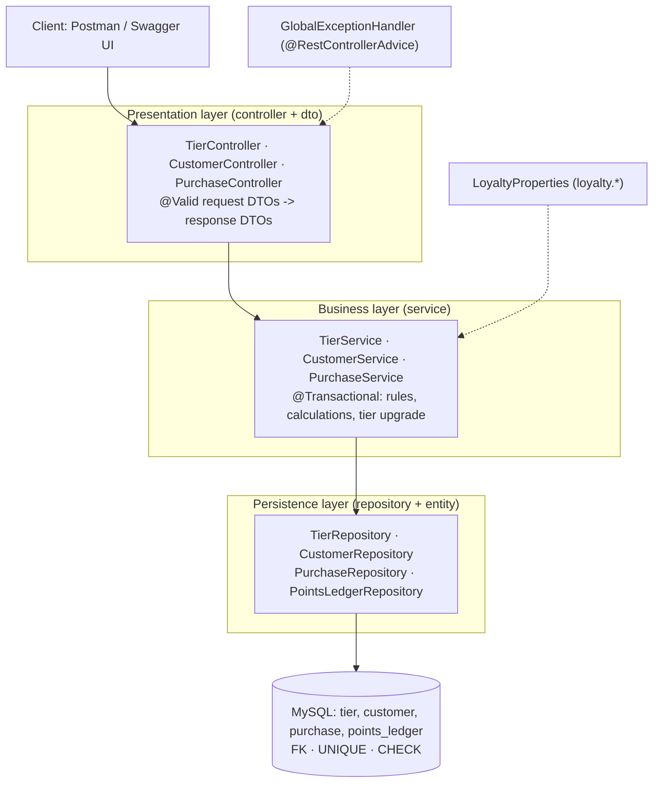
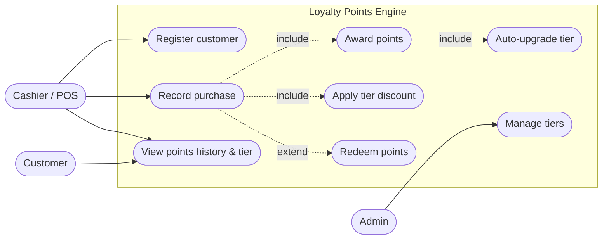
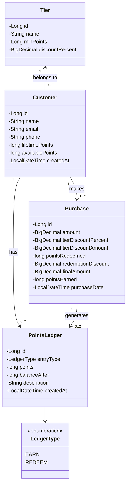
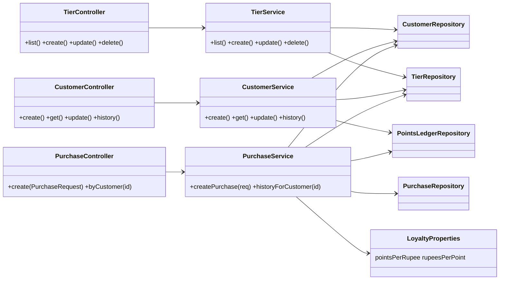
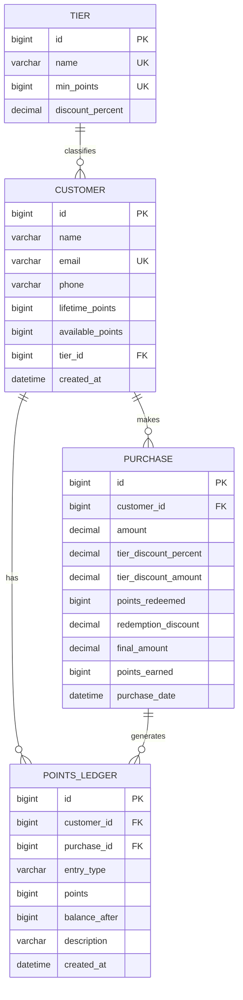
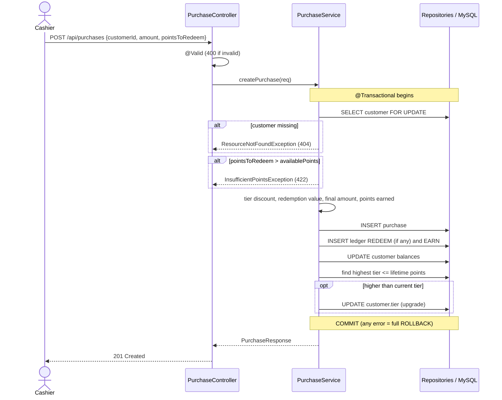
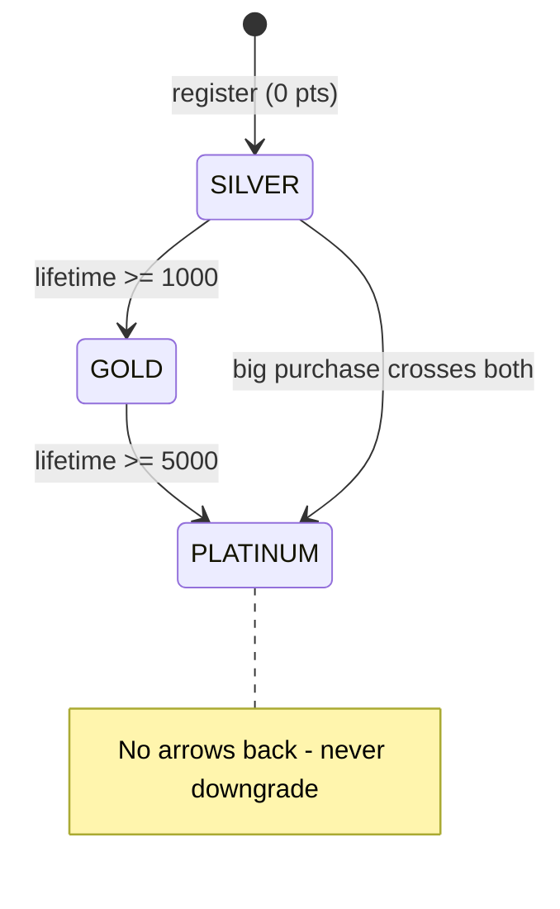

# Q61 — LoyaltyPoints: Tier-Based Retail Loyalty Points Engine
Spring Boot 4.1 · Java 26 · Spring Data JPA · MySQL 8 · Layered architecture

---

## 1. MVP (what to build, in priority order)

| Priority | Feature | Requirement # | Endpoint |
|---|---|---|---|
| **P0** | Tiers seeded (Silver / Gold / Platinum) | — | `GET /api/tiers` |
| **P0** | Register customer (starts at lowest tier) | — | `POST /api/customers` |
| **P0** | Award points per purchase (configurable rate) | 1 | `POST /api/purchases` |
| **P0** | Auto-upgrade tier when threshold crossed, never downgrade | 2 | inside `POST /api/purchases` |
| **P0** | Tier-based discount on new purchases | 3 | inside `POST /api/purchases` |
| **P0** | Redeem points for discount (cannot exceed balance) | 4 | `pointsToRedeem` in `POST /api/purchases` |
| **P0** | View points history + current tier | 5 | `GET /api/customers/{id}/points-history`, `GET /api/customers/{id}` |
| **P1** | Validation + global exception handler | Step 6 | all |
| **P1** | Swagger UI for testing/demo | Step 7 | `/swagger-ui.html` |
| **P1** | Tier CRUD, customer update | rubric "CRUD" | `/api/tiers`, `PUT /api/customers/{id}` |
| **P2** | Pagination on history (done), audit log, caching | "Ideas to go further" | — |

### Business rules & where they are enforced

| Rule | Service layer | Database layer |
|---|---|---|
| Tier never downgrades; upgrades automatically | `lifetimePoints` only ever increases; new tier applied only if its `minPoints` > current tier's | `lifetime_points >= 0` |
| Redeemed points ≤ available balance | check **before** saving → `InsufficientPointsException` (HTTP 422) | `CHECK (available_points >= 0 AND available_points <= lifetime_points)` |
| Amount must be positive | `@Positive` | `CHECK (amount > 0)` |
| Unique email / tier name / tier threshold | duplicate check → 409 | `UNIQUE` constraints |
| Ledger sign correctness | code sets sign | `CHECK ((EARN and points>0) or (REDEEM and points<0))` |
| Two simultaneous purchases can't double-spend | `SELECT … FOR UPDATE` on customer row | — |

### Calculation (worked example)
Config: `points-per-rupee = 1`, `rupees-per-point = 0.50`. Tiers: Silver 0 pts / 2 %, Gold 1000 / 5 %, Platinum 5000 / 10 %.

```
Customer on SILVER (2%), balance 100 pts, buys Rs. 1000, redeems 100 pts
  tier discount      = 1000 x 2%          = 20.00
  after tier         = 1000 - 20          = 980.00
  redemption value   = 100 x 0.50         = 50.00
  FINAL PAYABLE      = 980 - 50           = 930.00
  points earned      = floor(930 x 1)     = 930
  available          = 100 - 100 + 930    = 930
  lifetime           = old lifetime + 930 (redeeming never lowers lifetime)
```
Points are earned on the amount the customer **actually pays** (after discounts). State this in the viva; it is a design decision.

---

## 2. Layered architecture



Rule of thumb for viva: **controllers never touch repositories; entities never leave the service layer** (DTOs go out).

---

## 3. Use-case diagram



---

## 4. Class diagram



### Class diagram — layers



---

## 5. Schema design (ER diagram)



Design notes (good viva material):
* **Who owns whom:** `Customer` references `Tier` (many-to-one). `Purchase` and `PointsLedger` reference `Customer` (many-to-one). `PointsLedger.purchase_id` is nullable so manual adjustments can be added later.
* **`lifetime_points` vs `available_points`:** lifetime drives the tier (never decreases, so no downgrade); available is the spendable balance.
* **Ledger is append-only:** balance can always be audited/rebuilt from it. `balance_after` is a running snapshot.
* **Purchase stores a snapshot** of the discount % used, so old bills stay correct if you edit a tier later.
* **Money = `DECIMAL`/`BigDecimal`**, never `double`.
* Full DDL: `src/main/resources/schema.sql` (needs MySQL 8.0.16+ for CHECK to be enforced).

---

## 6. Purchase flow (sequence diagram)



### Tier state diagram


> Paste any mermaid block into https://mermaid.live to export PNG/SVG for your report or PPT.

---

## 7. Step-by-step build order

1. **Prereqs:** JDK 26, Maven, MySQL 8.0.16+, IntelliJ/VS Code/STS.
2. **Open the project** (`pom.xml` already has Web, JPA, Validation, MySQL driver, springdoc; no Lombok). If starting fresh: start.spring.io with those dependencies.
3. **Edit `application.properties`** — DB username/password. `createDatabaseIfNotExist=true` creates `loyalty_db` for you.
4. **Schema first:** `schema.sql` + `data.sql` (seeds 3 tiers). They run automatically on startup (`ddl-auto=none`, `sql.init.mode=always`), so the CHECK/FK rules live in the DB.
5. **Entities:** `Tier`, `Customer`, `Purchase`, `PointsLedger`, enum `LedgerType`.
6. **Repositories:** one `JpaRepository` each (+ derived queries for tiers, and the locking query on customers).
7. **DTOs + validation:** `@NotNull`, `@Positive`, `@Email`… on request records.
8. **Services:** `TierService`, `CustomerService`, then the core `PurchaseService.createPurchase` (features 1-4 in one `@Transactional`).
9. **Controllers:** one endpoint per feature, correct status codes (201 create, 404, 409, 422, 400).
10. **`GlobalExceptionHandler`:** clean JSON errors, no stack traces.
11. **Run:** `mvn spring-boot:run` → open `http://localhost:8080/swagger-ui.html`.
12. **Test** with the scenarios below; screenshot each for your report.
13. **Prepare the demo + viva** (section 9).

Suggested time-box if you are short on time: steps 3-6 (1 h) → step 8-9 (1.5 h) → 10-12 (1 h) → docs/diagrams (30 min).

---

## 8. API reference & test scenarios

| Method | URL | Purpose | Success |
|---|---|---|---|
| GET | `/api/tiers` | list tiers | 200 |
| POST/PUT/DELETE | `/api/tiers[/{id}]` | manage tiers | 201/200/204 |
| POST | `/api/customers` | register | 201 |
| GET | `/api/customers` · `/api/customers/{id}` | list / tier + balance + progress | 200 |
| PUT | `/api/customers/{id}` | update profile | 200 |
| GET | `/api/customers/{id}/points-history?page=0&size=10` | ledger, newest first | 200 |
| POST | `/api/purchases` | purchase (earn/discount/redeem/upgrade) | 201 |
| GET | `/api/purchases/customer/{id}` | purchase history | 200 |

Run these in order (assumes customer id = 1):

| # | Request | Expected |
|---|---|---|
| 1 | `POST /api/customers` `{"name":"Asha","email":"asha@mail.com","phone":"9999999999"}` | 201, tier SILVER, 0 points |
| 2 | `POST /api/purchases` `{"customerId":1,"amount":1000}` | tier discount 20, final 980, earned 980 |
| 3 | `POST /api/purchases` `{"customerId":1,"amount":200}` | discount 4, final 196, earned 196, lifetime 1176 → **tierUpgraded true, GOLD** |
| 4 | `POST /api/purchases` `{"customerId":1,"amount":500,"pointsToRedeem":100}` | GOLD 5 % discount now applies; redemption 50 |
| 5 | `POST /api/purchases` `{"customerId":1,"amount":500,"pointsToRedeem":999999}` | **422** "Cannot redeem … available balance is …" (nothing saved) |
| 6 | `POST /api/purchases` `{"customerId":1,"amount":-5}` | **400** validation error with field `amount` |
| 7 | `POST /api/purchases` `{"customerId":999,"amount":100}` | **404** |
| 8 | `POST /api/customers` same email again | **409** |
| 9 | `GET /api/customers/1/points-history` | EARN/REDEEM entries with running `balanceAfter` |
| 10 | `GET /api/customers/1` | tier GOLD, `nextTier: PLATINUM`, `pointsToNextTier` |
| 11 | `DELETE /api/tiers/1` (Silver, has customers? if none use Gold) | **422** when customers are on it |

Also prove the DB layer independently in MySQL Workbench:
```sql
UPDATE customer SET available_points = -5 WHERE id = 1;   -- rejected by CHECK
```

---

## 9. Viva cheat-sheet (likely questions)

* **Why DTOs?** Never expose entities; control the API shape; validation lives on DTOs.
* **Why `@Transactional` on the purchase?** Purchase + ledger + balance + tier update must be all-or-nothing.
* **Why validate before saving?** So a bad request is rejected with a clear error and nothing is half-written.
* **Why also DB CHECK constraints?** Defence in depth: even a buggy service or a manual SQL update can't corrupt balances.
* **Why lifetime vs available points?** Tier depends on lifetime (never drops when you redeem); spending uses available.
* **How do you stop double-spending?** Pessimistic lock (`SELECT … FOR UPDATE`) on the customer row.
* **Why BigDecimal?** Exact money arithmetic; `double` has rounding errors.
* **Why a ledger table?** Audit trail; balance is explainable and reconstructable.
* **What's configurable?** `loyalty.points-per-rupee`, `loyalty.rupees-per-point`, and tier thresholds/discounts (data, not code).
* **Improvements:** caching tier list, audit log, points expiry, JWT security, unit tests with Mockito, Flyway migrations.
